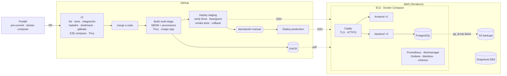

# TaskFlow · del portátil a producción

Aplicación full stack (React + Node.js/Express + PostgreSQL) con todo lo necesario para llevarla a
producción de forma profesional: contenedores endurecidos, CI/CD real en GitHub Actions con
supply-chain security, infraestructura como código en AWS, despliegues blue/green sin downtime,
rollback automático, backups verificados y observabilidad con alertas.



## Qué incluye

| Área | Implementación |
|---|---|
| **App** | API REST con health/readiness, métricas Prometheus, logs JSON, graceful shutdown, validación, migraciones con advisory lock. SPA React. |
| **Tests** | Unitarios (node:test, Vitest), integración contra PostgreSQL real, E2E del stack completo vía proxy, smoke tests post-deploy. |
| **Contenedores** | Multi-stage, imágenes base fijadas, usuario no-root, sin npm en runtime, `tini`, HEALTHCHECK, labels OCI. En runtime: `read_only`, `cap_drop: ALL`, `no-new-privileges`, límites de CPU/memoria, rotación de logs. |
| **CI** | Lint, tests con cobertura, `npm audit`, hadolint, shellcheck, validación de compose/Prometheus/Alertmanager/Caddy, gitleaks, E2E con Compose, Trivy. |
| **CD** | Build con caché, SBOM y provenance SLSA, escaneo Trivy del digest publicado, firma keyless con cosign, verificación de firma antes de desplegar, staging automático, producción con aprobación manual, concurrencia controlada. |
| **Despliegue** | Blue/green por servicio sin downtime, migraciones expand/contract, backup previo, restauración automática si falla, rollback automático si fallan los smoke tests, rollback manual a cualquier tag. |
| **Supply chain** | Actions fijadas por SHA, Dependabot (npm, Docker, Compose, Actions, Terraform), CodeQL, Trivy de repo e IaC, re-escaneo nocturno de imágenes. |
| **Infraestructura** | Terraform: VPC dedicada, security groups mínimos, EC2 con IMDSv2 y disco cifrado, IP elástica, rol IAM mínimo, SSM, S3 de backups (versionado, cifrado, write-only), snapshots EBS (DLM), auto-recover, DNS opcional. Estado remoto con lock. |
| **Servidor** | cloud-init: Docker oficial, usuario `deploy`, SSH solo con clave, fail2ban, ufw, parches automáticos, swap, cron de backups. |
| **Observabilidad** | Prometheus (RED + host + contenedores), blackbox externo con caducidad TLS, Alertmanager a Slack, Grafana con dashboard provisionado, alertas con runbook. |
| **Operación** | [docs/RUNBOOK.md](docs/RUNBOOK.md): deploy, rollback, backups/restore, rotación de secretos, respuesta a cada alerta. |

## Estructura

```
backend/            API Node.js (Express 5, pg, pino, prom-client) + Dockerfile
frontend/           SPA React (Vite) + nginx sin privilegios + Dockerfile
docker-compose.yml  Stack local "prod-like" (http://localhost:8080)
deploy/             Lo que se sincroniza en /opt/app del servidor
  docker-compose.prod.yml, Caddyfile, monitoring/, scripts/, .env.example
infra/terraform/    Infraestructura AWS por entorno (staging / production)
.github/            CI, CD, deploy reutilizable, seguridad, Terraform, Dependabot
docs/RUNBOOK.md     Operación y respuesta a incidentes
```

---

## 1. En el portátil

Requisitos: Docker Desktop (o Docker Engine + Compose v2), Node.js 24, Git. Opcional: `make`,
`pre-commit`, Terraform ≥ 1.10, AWS CLI.

```bash
# Stack completo con las mismas imágenes que producción
docker compose up -d --build proxy
bash deploy/scripts/smoke-test.sh http://localhost:8080
# → http://localhost:8080
```

Desarrollo con hot-reload:

```bash
docker compose up -d db
cd backend && npm ci && npm run migrate && npm run dev     # API en :3000
cd frontend && npm ci && npm run dev                       # Vite en :5173 (proxy /api → :3000)
```

Tests:

```bash
cd backend && npm test          # unitarios (los de integración se saltan sin DATABASE_URL)
cd frontend && npm test
make test-integration           # integración contra el PostgreSQL de compose
```

Hooks locales (mismo control que el CI, antes de hacer commit):

```bash
pip install pre-commit && pre-commit install
```

## 2. Preparar GitHub

1. Crea el repositorio y sube el código a `main`.
2. **Protección de `main`** (Settings → Rules): PR obligatorio, 1 aprobación, Code Owners, checks
   requeridos (`Backend`, `Frontend`, `Dockerfiles, shell y compose`, `Detección de secretos`, `E2E`),
   historial lineal, sin force-push. Edita [.github/CODEOWNERS](.github/CODEOWNERS).
3. **Claves SSH de despliegue**, una por entorno (nunca la de tu portátil):

   ```bash
   ssh-keygen -t ed25519 -N "" -C github-actions-staging    -f ./deploy_staging
   ssh-keygen -t ed25519 -N "" -C github-actions-production -f ./deploy_production
   ```

   La parte `.pub` va a los `.tfvars`; la privada, al GitHub Environment (paso 4). Después bórralas del disco.
4. **Environments** (Settings → Environments): crea `staging` y `production`.

   | Tipo | Nombre | Valor |
   |---|---|---|
   | Variable | `DEPLOY_HOST` | IP elástica (output `public_ip` de Terraform) |
   | Variable | `DOMAIN` | `staging.example.com` / `app.example.com` |
   | Variable | `DEPLOY_USER` | `deploy` (opcional) |
   | Secret | `SSH_PRIVATE_KEY` | contenido de `deploy_<env>` |
   | Secret | `SSH_KNOWN_HOSTS` | salida de `ssh-keygen -F <ip>` tras verificar la huella, o `ssh-keyscan -t ed25519 <ip>` comprobando la huella contra la consola de AWS |

   En `production` activa **Required reviewers** y restringe los despliegues a la rama `main`.
5. Si la organización usa gitleaks-action, añade el secreto `GITLEAKS_LICENSE` (gratis; no hace falta en cuentas personales).

## 3. Infraestructura con Terraform

Bucket de estado (una sola vez):

```bash
aws s3api create-bucket --bucket taskflow-tfstate-<sufijo> --region eu-west-1 \
  --create-bucket-configuration LocationConstraint=eu-west-1
aws s3api put-bucket-versioning --bucket taskflow-tfstate-<sufijo> --versioning-configuration Status=Enabled
aws s3api put-public-access-block --bucket taskflow-tfstate-<sufijo> \
  --public-access-block-configuration BlockPublicAcls=true,IgnorePublicAcls=true,BlockPublicPolicy=true,RestrictPublicBuckets=true
```

Edita `infra/terraform/environments/<env>.backend.hcl` (nombre del bucket) y `<env>.tfvars`
(dominio y claves públicas). Después:

```bash
cd infra/terraform
terraform init -backend-config=environments/staging.backend.hcl
terraform plan -var-file=environments/staging.tfvars -out=tfplan
terraform apply tfplan
terraform output
```

Para producción repite con `production.*` (usa `terraform init -reconfigure` al cambiar de backend).
Si no usas Route 53, crea un registro DNS **A** de tu dominio a `public_ip`.

> **Plan/apply desde GitHub (opcional):** crea un rol IAM con OIDC para
> `token.actions.githubusercontent.com` limitado a este repositorio, guarda su ARN en la variable
> de repositorio `AWS_ROLE_ARN` y crea los environments `infra-staging` / `infra-production` con
> aprobación. Los PRs mostrarán el plan y el apply se lanza desde Actions → Terraform.

## 4. Primer arranque del servidor

cloud-init deja Docker, el usuario `deploy` y `/opt/app` listos en ~3 minutos. Una única vez por entorno:

```bash
# Desde la raíz del repositorio, en tu portátil
rsync -az --exclude secrets/ deploy/ deploy@<ip>:/opt/app/
ssh deploy@<ip>
cd /opt/app
ALERT_WEBHOOK_URL=https://hooks.slack.com/services/XXX bash scripts/init-secrets.sh
nano .env      # DOMAIN, ACME_EMAIL, IMAGE_NAMESPACE (tu usuario de GitHub en minúsculas), BACKUP_S3_BUCKET
```

Si los paquetes de GHCR son privados, para que el rollback manual pueda descargar imágenes cuando el
pipeline no está activo, haz un `docker login ghcr.io` en el servidor con un PAT de solo `read:packages`
(o publica los paquetes como públicos).

## 5. Desplegar

```bash
git checkout -b feat/mi-cambio
# ... cambios + tests ...
git push -u origin feat/mi-cambio   # abre el PR → CI completo
```

Al hacer merge en `main`, el workflow **CD**:

1. Reejecuta el CI completo sobre `main`.
2. Construye las imágenes (`sha-<commit>`, `main`), genera SBOM y provenance, las escanea con Trivy y las firma con cosign.
3. Despliega en **staging**: verifica la firma, sincroniza `deploy/`, hace backup, migra, blue/green y smoke tests. Si los smoke tests fallan, rollback automático.
4. Espera la **aprobación manual** y repite en **production**.

Releases: `git tag v1.2.0 && git push --tags` publica además las etiquetas `1.2.0` y `1.2` de las imágenes.
Para redesplegar o volver a una versión concreta: Actions → **Deploy** → Run workflow (entorno + tag).

## 6. Observabilidad

Grafana solo escucha en loopback del servidor; se accede por túnel SSH:

```bash
ssh -L 3001:127.0.0.1:3001 deploy@<ip>     # → http://localhost:3001  (admin / secrets/grafana_admin_password)
```

El dashboard **TaskFlow · Visión general** muestra disponibilidad externa, réplicas sanas, días
hasta caducidad TLS, tasa de error, RPS por estado y ruta, latencia p50/p95/p99, event loop lag,
CPU/memoria por contenedor y recursos del host. Las alertas (caída, tasa de 5xx, latencia,
certificado, disco, memoria, CPU) llegan a Slack con enlace al runbook.

## Decisiones de diseño

- **Compose en una VM en lugar de Kubernetes.** Para un servicio de este tamaño es más barato,
  más simple de operar y sigue siendo reproducible e inmutable (imágenes firmadas + config en Git).
  El salto a ECS/Kubernetes es directo porque las imágenes ya son stateless, configuradas por
  entorno, con health/readiness y graceful shutdown.
- **Migraciones forward-only con expand/contract.** Permiten blue/green y rollback de la aplicación
  sin tocar el esquema. Para cambios destructivos: release 1 añade (expand), release 2 deja de usar,
  release 3 elimina (contract).
- **Secretos.** Nunca en Git ni en imágenes. En el servidor como Docker secrets (`/run/secrets`), en
  GitHub como secretos por environment, en AWS vía rol IAM (sin claves estáticas). Siguiente paso
  natural: AWS Secrets Manager/SSM Parameter Store o SOPS.
- **SSH desde runners de GitHub.** Sus IPs no son fijas, así que el puerto 22 queda abierto con
  autenticación solo por clave y fail2ban. Para cerrarlo del todo: runner self-hosted, VPN
  (Tailscale) o despliegue mediante AWS SSM Run Command.
- **Base de datos en la misma VM.** Backups lógicos diarios a S3 + snapshots EBS. Si el RPO/RTO
  lo exige, mover a Amazon RDS (Multi-AZ, PITR) cambiando solo `DB_HOST` y el secreto.

## Siguientes pasos recomendados

- RDS Multi-AZ y un ALB con varias instancias (o ECS Fargate) cuando haga falta alta disponibilidad.
- Logs centralizados (Loki + Alloy, o CloudWatch Logs) y trazas con OpenTelemetry.
- Tests de carga (k6) en staging dentro del pipeline y SLOs con error budgets.
- Entornos efímeros por PR.
