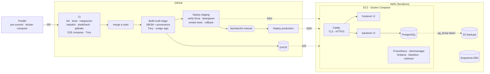

# TaskFlow

La app en sí es una lista de tareas (React, Node.js/Express y PostgreSQL). Lo que me
interesaba era todo lo que hay alrededor para llevarla del portátil a producción:
contenedores, CI/CD en GitHub Actions, infraestructura en AWS con Terraform, despliegues
blue/green con rollback automático, backups y monitorización.



## Qué tiene

- Una API REST con health checks, métricas para Prometheus, logs en JSON y apagado
  ordenado, y un frontend en React con Vite.
- Pruebas unitarias, de integración contra un PostgreSQL real y un E2E que levanta todo
  el stack con Docker Compose. Después de cada despliegue corren unos smoke tests.
- Imágenes multi-stage que corren sin root, con sistema de archivos de solo lectura y
  límites de CPU y memoria.
- En cada PR el CI pasa lint, tests, `npm audit`, hadolint, shellcheck, gitleaks y Trivy.
- Al hacer merge, las imágenes se construyen una vez, se escanean, se firman con cosign
  y se publican en GHCR. Staging se despliega solo; producción espera una aprobación
  manual.
- El despliegue es blue/green por servicio: hace backup, migra y, si fallan los smoke
  tests, vuelve solo a la versión anterior.
- La infraestructura está en Terraform: VPC, EC2, IP elástica, S3 para backups y
  snapshots de EBS. El servidor se prepara con cloud-init.
- Prometheus, Alertmanager (avisa por Slack) y Grafana con un dashboard ya montado.
- Un [runbook](docs/RUNBOOK.md) con qué hacer en cada alerta, cómo hacer rollback y cómo
  restaurar un backup.

## Estructura

```
backend/            API Node.js (Express 5, pg, pino, prom-client) + Dockerfile
frontend/           SPA React (Vite) + nginx sin privilegios + Dockerfile
docker-compose.yml  Stack local "prod-like" (http://localhost:8080)
deploy/             Lo que se sincroniza en /opt/app del servidor
  docker-compose.prod.yml, Caddyfile, monitoring/, scripts/, .env.example
infra/terraform/    Infraestructura AWS por entorno (staging / production)
.github/            CI, CD, deploy reutilizable, seguridad, Terraform, Dependabot
docs/RUNBOOK.md     Operación y respuesta a incidentes
```

## 1. En local

Necesitas Docker Desktop (o Docker Engine + Compose v2), Node.js 24 y Git. Para el resto
de pasos también `make`, `pre-commit`, Terraform ≥ 1.10 y AWS CLI.

```bash
# Stack completo con las mismas imágenes que producción
docker compose up -d --build proxy
bash deploy/scripts/smoke-test.sh http://localhost:8080
# → http://localhost:8080
```

Para probar con las imágenes que publica el pipeline (las mismas que van a producción; la
app muestra la versión y el commit):

```bash
docker compose -f docker-compose.yml -f docker-compose.demo.yml up -d --no-build proxy
```

Con la app publicada en una URL pública, **Actions → Prueba en vivo → Run workflow** crea
una tarea desde fuera, comprueba que llega a PostgreSQL, la deja unos segundos en la app y
la borra. El resumen del job muestra cada paso y cuánto tardó. En local (necesita `curl`
y `jq`):

```bash
bash deploy/scripts/live-check.sh http://localhost:8080 5
```

Desarrollo con hot-reload:

```bash
docker compose up -d db
cd backend && npm ci && npm run migrate && npm run dev     # API en :3000
cd frontend && npm ci && npm run dev                       # Vite en :5173 (proxy /api → :3000)
```

Tests:

```bash
cd backend && npm test          # unitarios (los de integración se saltan sin DATABASE_URL)
cd frontend && npm test
make test-integration           # integración contra el PostgreSQL de compose
```

Hooks de pre-commit (los mismos controles que el CI):

```bash
pip install pre-commit && pre-commit install
```

## 2. GitHub

1. Haz un fork o sube el código a un repo tuyo, en `main`.
2. Protege `main` (Settings → Rules): PR obligatorio con 1 aprobación, Code Owners,
   checks requeridos (`Backend`, `Frontend`, `Dockerfiles, shell y compose`,
   `Detección de secretos`, `E2E`), historial lineal y sin force-push. Cambia
   [.github/CODEOWNERS](.github/CODEOWNERS) por tu usuario.
3. Crea una clave SSH de despliegue por entorno (no uses la de tu portátil):

   ```bash
   ssh-keygen -t ed25519 -N "" -C github-actions-staging    -f ./deploy_staging
   ssh-keygen -t ed25519 -N "" -C github-actions-production -f ./deploy_production
   ```

   La `.pub` va a los `.tfvars` y la privada al environment de GitHub (paso 4). Luego
   bórralas del disco.
4. En Settings → Environments crea `staging` y `production` con esto:

   | Tipo | Nombre | Valor |
   |---|---|---|
   | Variable | `DEPLOY_HOST` | IP elástica (output `public_ip` de Terraform) |
   | Variable | `DOMAIN` | `staging.example.com` / `app.example.com` |
   | Variable | `DEPLOY_USER` | `deploy` (opcional) |
   | Secret | `SSH_PRIVATE_KEY` | contenido de `deploy_<env>` |
   | Secret | `SSH_KNOWN_HOSTS` | salida de `ssh-keygen -F <ip>` tras verificar la huella, o `ssh-keyscan -t ed25519 <ip>` comprobando la huella contra la consola de AWS |

   En `production` activa **Required reviewers** y limita los despliegues a `main`.

   Mientras no existan los servidores, el CD construye, escanea, firma y publica las
   imágenes pero no despliega. Cuando estén listos (paso 4), actívalo con
   `gh variable set DEPLOY_ENABLED --body true`.

## 3. Terraform

El bucket para el estado se crea una sola vez:

```bash
aws s3api create-bucket --bucket taskflow-tfstate-<sufijo> --region eu-west-1 \
  --create-bucket-configuration LocationConstraint=eu-west-1
aws s3api put-bucket-versioning --bucket taskflow-tfstate-<sufijo> --versioning-configuration Status=Enabled
aws s3api put-public-access-block --bucket taskflow-tfstate-<sufijo> \
  --public-access-block-configuration BlockPublicAcls=true,IgnorePublicAcls=true,BlockPublicPolicy=true,RestrictPublicBuckets=true
```

Pon el nombre del bucket en `infra/terraform/environments/<env>.backend.hcl` y el dominio
y las claves públicas en `<env>.tfvars`. Luego:

```bash
cd infra/terraform
terraform init -backend-config=environments/staging.backend.hcl
terraform plan -var-file=environments/staging.tfvars -out=tfplan
terraform apply tfplan
terraform output
```

Para producción, lo mismo con `production.*` (con `terraform init -reconfigure` al cambiar
de backend). Si no usas Route 53, crea un registro **A** de tu dominio a `public_ip`.

También se puede hacer plan/apply desde GitHub: crea un rol IAM con OIDC para
`token.actions.githubusercontent.com` limitado a este repo, guarda su ARN en la variable
`AWS_ROLE_ARN` y crea los environments `infra-staging` / `infra-production` con
aprobación. Los PRs muestran el plan y el apply se lanza desde Actions → Terraform.

## 4. Primer arranque del servidor

cloud-init deja Docker, el usuario `deploy` y `/opt/app` listos en unos 3 minutos. Después,
una vez por entorno:

```bash
# Desde la raíz del repositorio, en tu portátil
rsync -az --exclude secrets/ deploy/ deploy@<ip>:/opt/app/
ssh deploy@<ip>
cd /opt/app
ALERT_WEBHOOK_URL=https://hooks.slack.com/services/XXX bash scripts/init-secrets.sh
nano .env      # DOMAIN, ACME_EMAIL, IMAGE_NAMESPACE (tu usuario de GitHub en minúsculas), BACKUP_S3_BUCKET
```

Si los paquetes de GHCR son privados, haz `docker login ghcr.io` en el servidor con un PAT
que solo tenga `read:packages`, para que el rollback manual pueda bajar imágenes aunque el
pipeline no esté corriendo (o publica los paquetes).

## 5. Desplegar

```bash
git checkout -b feat/mi-cambio
# ... cambios + tests ...
git push -u origin feat/mi-cambio   # abre el PR → CI completo
```

Al hacer merge en `main`, el workflow **CD**:

1. Vuelve a pasar el CI completo sobre `main`.
2. Construye las imágenes (`sha-<commit>`, `main`), genera SBOM y provenance, las escanea con Trivy y las firma con cosign.
3. Despliega en staging: verifica la firma, sincroniza `deploy/`, hace backup, migra, cambia blue/green y corre los smoke tests. Si fallan, hace rollback.
4. Espera la aprobación manual y repite en production.

Para una release: `git tag v1.2.0 && git push --tags` publica además las etiquetas `1.2.0` y
`1.2`. Para volver a una versión concreta: Actions → **Deploy** → Run workflow (entorno + tag).

## 6. Monitorización

Grafana solo escucha en el loopback del servidor, así que se entra por un túnel SSH:

```bash
ssh -L 3001:127.0.0.1:3001 deploy@<ip>     # → http://localhost:3001  (admin / secrets/grafana_admin_password)
```

El dashboard **TaskFlow · Visión general** muestra disponibilidad, réplicas sanas, días
hasta que caduca el certificado, errores, peticiones por segundo, latencia p50/p95/p99 y
CPU y memoria por contenedor. Las alertas llegan a Slack con el enlace a la sección del
runbook que toca.

## Por qué lo hice así

- **Docker Compose en una VM y no Kubernetes.** Para algo de este tamaño es más barato y
  más fácil de operar, y sigue siendo reproducible: imágenes firmadas y configuración en
  Git. Si algún día hace falta, pasar a ECS o Kubernetes es directo porque las imágenes
  ya no guardan estado y se configuran por entorno.
- **Migraciones solo hacia delante (expand/contract).** Así el blue/green y el rollback
  no tocan el esquema. Un cambio destructivo va en tres releases: la primera añade, la
  segunda deja de usar lo viejo y la tercera lo borra.
- **Secretos.** Nunca en Git ni en las imágenes. En el servidor van como Docker secrets,
  en GitHub como secretos por environment y en AWS por rol IAM, sin claves fijas.
- **SSH desde los runners de GitHub.** Sus IPs cambian, así que el puerto 22 queda
  abierto, solo con clave y fail2ban. Para cerrarlo habría que usar un runner propio, una
  VPN o AWS SSM.
- **Base de datos en la misma VM.** Hay backup diario a S3 y snapshots de EBS. Si hiciera
  falta más disponibilidad, se pasa a RDS cambiando `DB_HOST` y el secreto.

## Pendiente

- RDS Multi-AZ y varias instancias detrás de un balanceador.
- Logs centralizados y trazas con OpenTelemetry.
- Pruebas de carga con k6 en staging.
